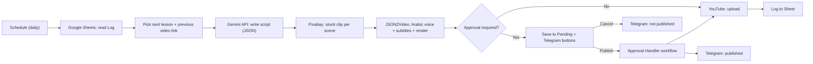

# n8n YouTube Course Automation

An n8n automation that produces and publishes a **daily educational short video** to YouTube — script, Arabic voice-over, subtitles, rendering, optional approval from Telegram, publishing, and logging — with no manual editing.

It was built to run a sequential course ("Learn AI automation with n8n from zero", 30 lessons), but the topic list, language, voice and schedule can be changed.

> 🇸🇦 النسخة العربية: [README.ar.md](README.ar.md)

## How it works

## Features

- **Fully scheduled** — one video per day (cron expression, default `0 11 * * *`).
- **Sequential course engine** — lesson number is computed from the Log sheet, so a failed run retries the same lesson instead of skipping it.
- **AI script writing** with the Gemini API, constrained to short scenes (≈35–45 s) with a word-count safety net.
- **Arabic voice-over + auto subtitles**, rendered to a 9:16 video by JSON2Video.
- **Different stock clip per scene** (Pixabay) where possible.
- **Telegram approval with inline buttons** (Publish / Cancel) — the answer comes back inside Telegram, no browser redirect.
- **Error alerts** to Telegram through a dedicated error workflow.
- **Privacy switch** (`private` / `unlisted` / `public`) from one `Config` node.
- **Previous-lesson link** appended to each video description.
- **Google Sheets log** of everything that was published.

## Repository contents

| Path | Description |
|---|---|
| `workflows/youtube-course-main.json` | Main pipeline (schedule → script → render → approval request / upload) |
| `workflows/youtube-approval-handler.json` | Listens to the Telegram buttons, publishes or cancels |
| `workflows/youtube-error-notifier.json` | Sends a Telegram message when a workflow fails |
| `templates/log.csv` | Header row for the `Log` sheet |
| `templates/pending.csv` | Header row for the `Pending` sheet |

All credentials, IDs and chat IDs have been removed. You must add your own.

## Requirements

- n8n 2.x (self-hosted or cloud) reachable over public HTTPS (required by the Telegram Trigger)
- Google account: Google Sheets + YouTube Data API OAuth credentials
- API keys: [Gemini API](https://aistudio.google.com/), [Pixabay](https://pixabay.com/api/docs/), [JSON2Video](https://json2video.com/)
- A Telegram bot (create a **new** bot with @BotFather — one bot can only have one active Trigger webhook)

## Setup

1. **Create a Google Sheet** with two tabs:
   - `Log` — header row from `templates/log.csv`
   - `Pending` — header row from `templates/pending.csv`
2. **Create credentials in n8n:**

   | Used by node(s) | Credential type | Details |
   |---|---|---|
   | `Google Script` | Header Auth | Name `x-goog-api-key`, value = Gemini API key |
   | `Pixabay Search` | Query Auth | Name `key`, value = Pixabay API key |
   | `Create Movie`, `Get Status` | Header Auth | Name `x-api-key`, value = JSON2Video API key |
   | Google Sheets nodes | Google Sheets OAuth2 | — |
   | `YouTube Upload` | YouTube OAuth2 | Publish the OAuth app to *Production* so the token doesn't expire after 7 days |
   | Telegram nodes | Telegram API | Bot token from @BotFather |

3. **Import each workflow into its own empty workflow** (⋯ → Import from File):
   `youtube-error-notifier.json`, `youtube-approval-handler.json`, then `youtube-course-main.json`.
4. **Replace the placeholders:** `YOUR_GOOGLE_SHEET_ID` (Sheets nodes) and `YOUR_TELEGRAM_CHAT_ID` (Telegram send nodes). Select your credentials on every node that asks for one.
5. **Link the error workflow:** in the main and handler workflows → Settings → *Error workflow* → `YouTube Course - Error Notifier`.
6. **Activate** the approval handler (it must be active to receive button clicks), then the main workflow.
7. In the `Config` node set `privacy` (`private` recommended for the first runs) and `requireApproval` (`true` / `false`).

## Customisation

- **Topic / course:** edit the `LESSONS` array and the prompt inside the `Build Prompt` code node.
- **Language and voice:** change `VOICE` in `Build Movie` and the prompt language.
- **Schedule:** change the cron expression in `Schedule`.
- **Video size:** `width` / `height` in `Build Movie` (default 1080×1920).
- **LLM model:** `MODEL` in `Build Prompt`.

## Known limitations

- JSON2Video limits video length per plan (the free tier is 60 s per video). Keep scripts short or upgrade.
- YouTube treats uploads from unaudited API projects as private-locked. Check the YouTube API Services audit requirements if videos stay private.
- Stock footage is generic; it does not show the real software UI. For hands-on lessons, record your own screen.
- LLM scripts can contain factual mistakes — review the first videos and keep the approval step on.
- Disclose AI-generated/synthetic content in YouTube Studio where required, and respect YouTube's policies on repetitive or mass-produced content.
- Preview links from JSON2Video are temporary; approve within a day or two.

## License

MIT — see [LICENSE](LICENSE).
